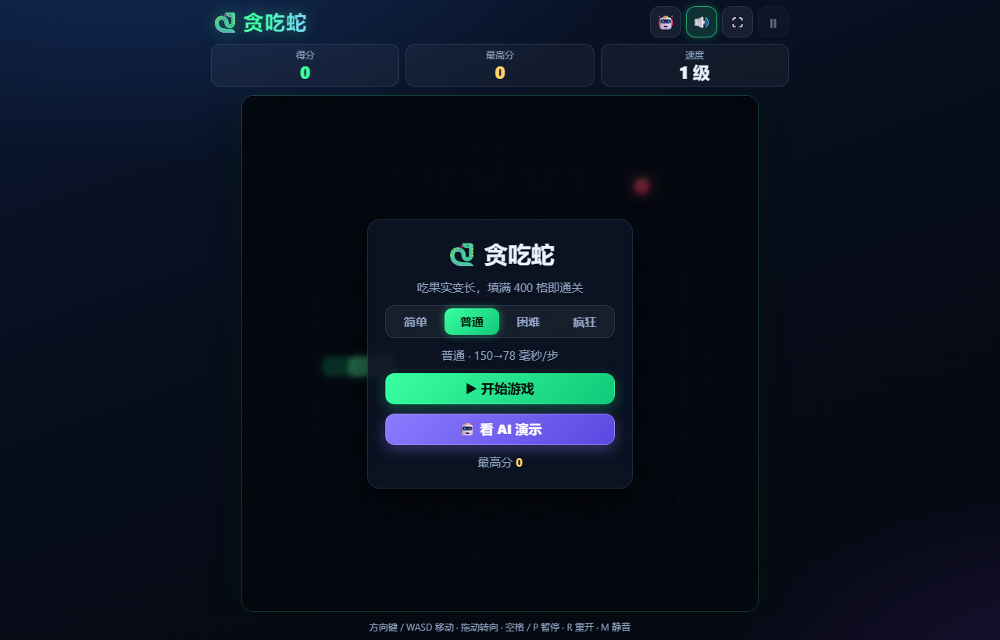
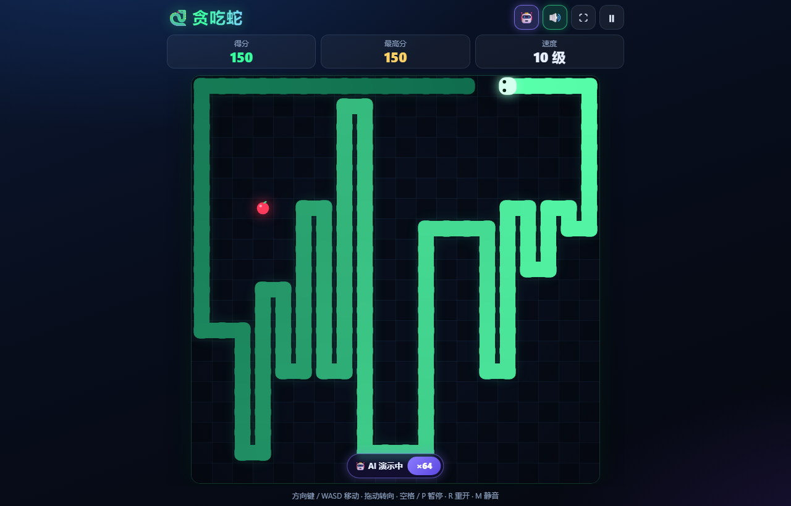
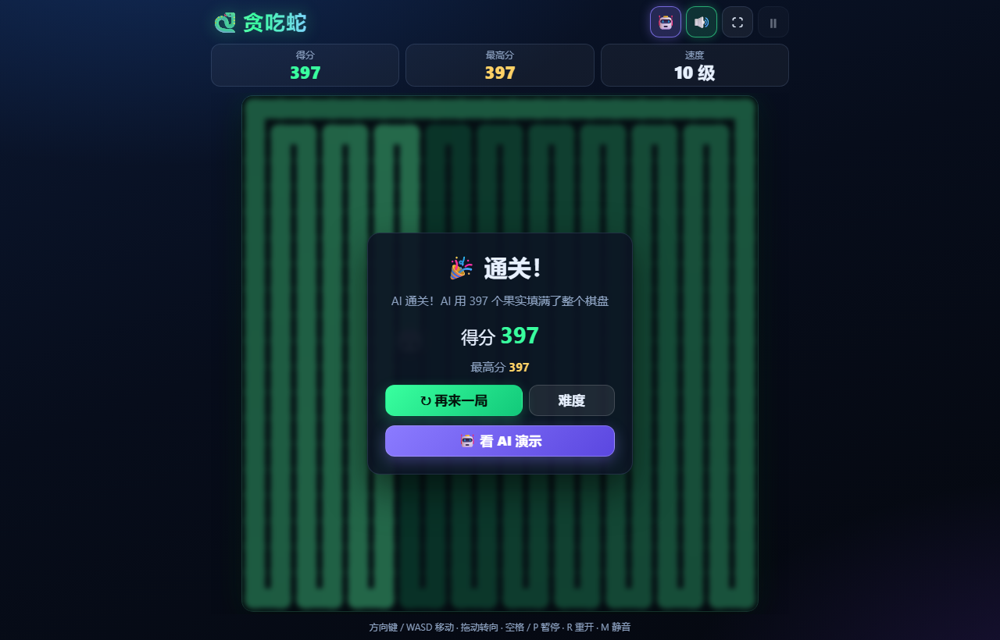
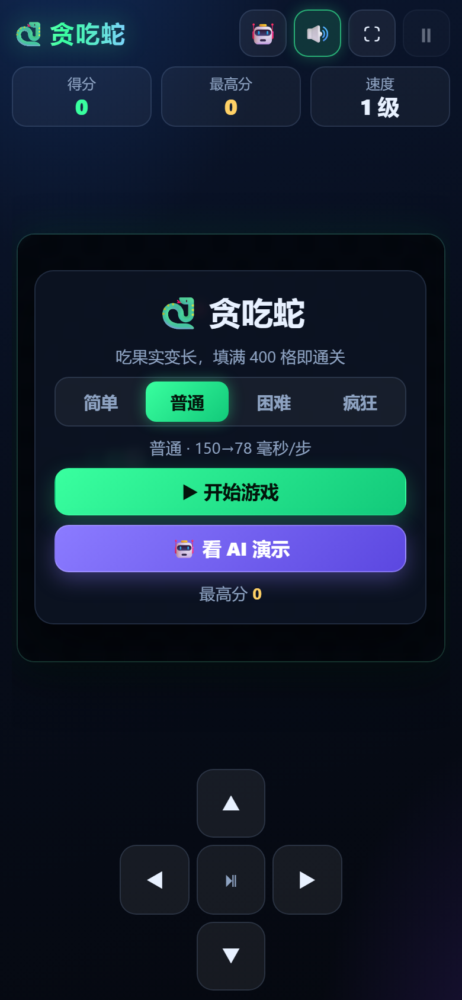
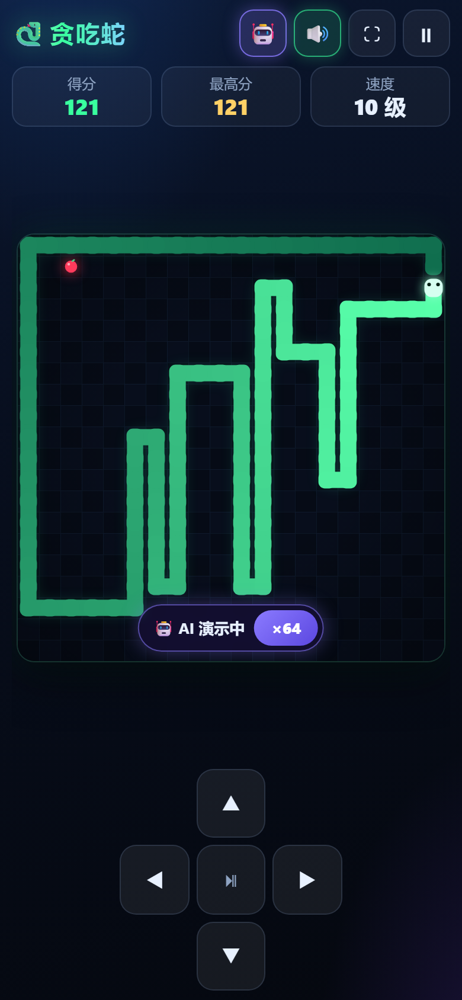
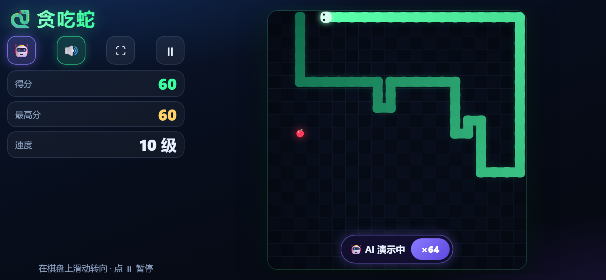
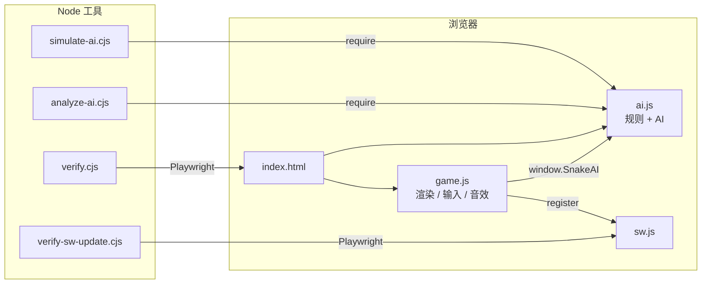

# 🐍 贪吃蛇（Snake）

纯原生 HTML / CSS / JS（ES2020）写的贪吃蛇，**零依赖、零构建**。网页、手机、桌面（PWA 安装）都能玩，内置一个**保证通关**的 AI 演示模式。

- 双击 `index.html`（`file://`）就能玩；
- 全部使用相对路径，可以放到任意静态目录或 GitHub Pages 子路径；
- 通过 HTTP(S) 访问时自动注册 Service Worker，支持离线，可在 Chrome / Edge 里「安装」成独立应用；
- 规则和 AI 共用 `ai.js`，Node 无头模拟和浏览器端到端测试都 0 失败。

| 桌面 · 开始界面 | 桌面 · AI 演示中 | 桌面 · AI 通关 |
| --- | --- | --- |
|  |  |  |

| 手机竖屏 · 开始界面 | 手机竖屏 · AI 演示 | 手机横屏 · 紧凑模式 |
| --- | --- | --- |
|  |  |  |

## 目录

- [快速开始](#快速开始)
- [玩法](#玩法)
- [操作](#操作)
- [AI 演示模式](#ai-演示模式)
- [界面与适配](#界面与适配)
- [PWA、离线与更新](#pwa离线与更新)
- [项目结构](#项目结构)
- [开发与验证](#开发与验证)
- [部署](#部署)
- [发布新版本](#发布新版本)
- [常见问题](#常见问题)
- [更多文档](#更多文档)

## 快速开始

**直接玩**：双击 `index.html`。`file://` 下不能注册 Service Worker，离线和安装功能不可用，游戏本身完全可玩。

**本地 HTTP**（可以测试离线和 PWA 安装）：

```bash
node tools/serve.cjs 8080
# 打开 http://127.0.0.1:8080/
```

`tools/serve.cjs` 是零依赖的静态服务器，第一个参数是端口。端口被占用时换一个即可，例如 `node tools/serve.cjs 9317`。用 `python -m http.server` 或其它任何静态服务器也可以。

**安装为应用**：用 Chrome / Edge 通过 `http://localhost` / `http://127.0.0.1` 或 HTTPS 打开，地址栏出现「安装」图标后点击即可。手机浏览器用「添加到主屏幕」。

## 玩法

- 棋盘 20×20，蛇初始 3 节，向右出发。
- 吃一个果实 +1 分，蛇身变长一节。
- 每 4 分升 1 级，最高 10 级，等级越高速度越快。
- 撞墙或咬到自己就结束；蛇身填满全部 400 格（吃到 397 个果实）进入「通关」面板。
- 最高分存在 `localStorage`，**刷新纪录的那一刻就写入**。中途按 R 重开或刷新页面都不会丢。

### 难度

四档难度只改变速度（毫秒/步，1 级 → 10 级线性插值）。选择会被记住，开始界面用分段选择器切换，当前项高亮。

| 难度 | 1 级 | 10 级 |
| --- | --- | --- |
| 简单 easy | 230 ms | 150 ms |
| 普通 normal | 150 ms | 78 ms |
| 困难 hard | 105 ms | 58 ms |
| 疯狂 insane | 70 ms | 38 ms |

## 操作

| 输入方式 | 操作 |
| --- | --- |
| 键盘 | 方向键 / WASD 移动；空格或 P 暂停 / 继续；R 随时重开；Enter 结束后重开；M 静音；F 全屏 |
| 鼠标 | 在棋盘上按住拖动，位移超过阈值就转向；按住不放可以连续转向 |
| 触摸 | 在棋盘上滑动转向；竖屏底部有方向键，中间键暂停 / 继续；横屏矮屏隐藏方向键，改用滑动 |
| 顶部按钮 | 🤖 AI 演示开关、🔊 声音、⛶ 全屏、⏸ 暂停 |

- 转向队列最多缓存 2 次转向，快速连按「上 → 左」不会被吞掉；180° 掉头会被忽略。
- 切到后台、窗口失焦时自动暂停。
- 声音由 WebAudio 实时合成（吃果实、升级、死亡、开始、通关），首次用户交互后才创建 AudioContext。
- 手机上吃果实短震动，死亡长震动（仅在支持 `navigator.vibrate` 时）。静音同时关闭震动。

## AI 演示模式

开始、结束、通关面板都有「🤖 看 AI 演示」按钮；右上角 🤖 可以随时开关。

- 演示条显示「🤖 AI 演示中」，点击倍速按钮循环 **×1 → ×4 → ×16 → ×64 → MAX**。×1~×64 在当前难度和等级的步速上加速；MAX 固定为 1400 步/秒，约 **20~26 秒**通关。
- 演示时忽略玩家方向输入；暂停、继续、全屏照常可用。
- AI 的成绩同样计入最高分。通关面板显示「AI 通关！AI 用 397 个果实填满了整个棋盘」。
- 游戏中途打开 🤖：如果当前蛇身满足 AI 的安全条件就直接接管，否则开一局新的 AI 演示。

### 为什么保证通关

1. 预先计算一条经过全部 400 格的**哈密顿环**（第 0 列向下 → 其余列蛇形往返 → 沿第 0 行向左闭合），每格有唯一环序号 `order`。
2. **安全规则**：蛇头只能落到环上「头 → 尾」之间的空格，即 `step ≤ (order[尾] − order[头]) mod 400`。蛇头永远追不上自己的尾巴，所以**永不咬到自己**。
3. 沿环走 1 步永远合法，所以**永不卡死**；蛇头始终沿环前进，环经过每一格，所以**一定会吃到果实**，最终**填满棋盘**。
4. **抄近路**：在合法走法中按 `[能吃到果实, 沿环到果实剩余步数, 曼哈顿距离, 环步长]` 排序择优。
5. **门控**：空地少于蛇长 × 1.25 时禁止跳格（吃果实、沿环 1 步除外），避免后期在身后留下零散空洞；门控后没有合法走法时退回不门控版本重算。

完整推导、伪代码和效率数据见 [docs/AI.md](docs/AI.md)。

## 界面与适配

- 结构：顶部（标题 + 4 个图标）→ 计分（得分 / 最高分 / 速度）→ 棋盘 + 弹层 → 底部（键盘提示；触屏设备换成方向键）。
- **棋盘始终正方形且完整可见**：`ResizeObserver` 监听可用空间，取 `min(宽, 高)` 并对齐到 20 的倍数实时重算；canvas 按 `devicePixelRatio`（上限 2.5）高清渲染。
- 视觉：深色渐变背景、圆角发光蛇身（头亮尾暗）、脉动果实、网格底纹、吃果实光环、死亡红闪和屏幕震动。
- 适配 `env(safe-area-inset-*)` 刘海屏；横屏矮屏（高度 ≤ 520px）切换为「左侧信息栏 + 右侧棋盘」紧凑模式；320px 宽不溢出；页面无滚动条。
- 弹层可见时不对 canvas 调用 `setPointerCapture`，弹层里的按钮始终点得动。
- 无障碍：按钮都有 `aria-label` / `aria-pressed`，键盘焦点可见，`prefers-reduced-motion` 时关闭动画、震屏和脉动。
- 标签页标题实时同步：`得分 12 · 贪吃蛇` / `已暂停 · 得分 12 · 贪吃蛇` / `通关 · 得分 397 · 贪吃蛇`。

## PWA、离线与更新

- `manifest.webmanifest`：`name`、`short_name`、`id`、`start_url`、`scope`、`display: standalone`、`theme_color` / `background_color` 为 `#05080f`，含 192、512 和 maskable 图标。
- `sw.js` 采用**网络优先 + 缓存兜底**（包括导航请求，离线时兜底到 `index.html`）：在线时总是拿最新代码并顺手刷新缓存，断网时用缓存。
- `activate` 时清理旧版本缓存，并 `clients.claim()`。
- 静态资源统一带版本号（`style.css?v=1`、`ai.js?v=1`、`game.js?v=1`），SW 的预缓存列表与之同步。
- 注册时使用 `updateViaCache: 'none'` 并主动 `reg.update()`。页面原本已受旧 SW 控制时，新 SW 接管后自动 `location.reload()` 一次，用户刷新一次就能看到新版本；首次安装不会刷新。

## 项目结构

```
.
├── index.html               页面结构与弹层
├── style.css                样式（深色霓虹、响应式、紧凑模式、无障碍）
├── ai.js                    核心规则 + 保证通关的 AI（UMD：window.SnakeAI / require）
├── game.js                  渲染、输入、音效、震动、HUD、PWA 注册
├── manifest.webmanifest     PWA 清单
├── sw.js                    Service Worker（网络优先 + 缓存兜底）
├── icons/                   192 / 512 / maskable 图标（由 tools/make_icons.py 生成）
├── docs/
│   ├── AI.md                AI 算法说明、正确性论证与效率数据
│   ├── TESTING.md           验证脚本说明与最近一次运行结果
│   └── screenshots/         README 截图（由 tools/screenshots.cjs 生成）
├── tools/
│   ├── simulate-ai.cjs      AI 无头模拟（4 难度 × 5 种子，断言全部通关）
│   ├── analyze-ai.cjs       AI 效率分析（基线 / 本策略 / 下界，分阶段统计）
│   ├── verify.cjs           Playwright 端到端验证（4 种视口 + file://）
│   ├── verify-sw-update.cjs Service Worker 离线 / 旧缓存 / 发版更新验证
│   ├── screenshots.cjs      生成 docs/screenshots/ 截图
│   ├── serve.cjs            零依赖静态服务器
│   └── make_icons.py        用 Pillow 生成图标（可重复执行，输出确定）
├── CHANGELOG.md
└── LICENSE
```

### 模块关系



`ai.js` 同时包含游戏规则（`createGame` / `step` / `spawnFood`）和 AI。浏览器里的 `game.js` 和 Node 里的模拟脚本调用的是**同一个** `step()`，所以模拟结论对真实游戏成立。

`ai.js` 对外导出的主要接口：

| 接口 | 说明 |
| --- | --- |
| `createGame({ rng })` | 新建一局（可传入随机数函数，便于复现） |
| `step(game, dir)` | 推进一步，返回 `{ ate, died, won, levelUp, cell }` |
| `createAI(cols, rows, options)` | 创建 AI，`decide(game)` 返回下一步方向；`options.shortcuts=false` 为纯绕环基线，`options.gateRatio` 调整门控系数 |
| `buildCycle` / `verifyCycle` | 生成 / 校验哈密顿环 |
| `levelForScore` / `intervalFor` | 等级与步速计算 |
| `mulberry32(seed)` | 可复现的伪随机数生成器 |

## 开发与验证

游戏本身没有依赖。验证脚本需要：

- Node.js 18+（开发时使用 Node 24）；
- Playwright + Chromium（只有浏览器验证和截图脚本需要）：`npm i -D playwright && npx playwright install chromium`。脚本也会自动尝试全局安装的 Playwright；
- Python 3 + Pillow（只有图标生成需要）：`pip install pillow`。

```bash
node tools/simulate-ai.cjs          # AI 无头模拟：4 难度 × 5 种子，全部填满 400 格
node tools/analyze-ai.cjs           # AI 效率分析
node tools/verify.cjs               # 浏览器端到端：1280×820 / 390×844 / 844×390 / 320×568 + file://
node tools/verify-sw-update.cjs     # Service Worker 离线与更新
python tools/make_icons.py          # 重新生成图标
node tools/screenshots.cjs          # 重新生成 README 截图
```

- `node tools/simulate-ai.cjs 20`：每档难度跑 20 个种子。
- `ONLY=桌面 node tools/verify.cjs`：只跑某个环境（`桌面` / `竖屏` / `横屏` / `320` / `file`）。
- `HEADED=1 node tools/verify.cjs`：以有界面模式观察自动游玩。

各脚本检查了什么、最近一次的真实输出，见 [docs/TESTING.md](docs/TESTING.md)。

## 部署

把仓库根目录原样上传到任意静态服务器即可（`tools/`、`docs/` 可选）。所有路径都是相对路径，放在子路径下也能用。

**GitHub Pages**：仓库 Settings → Pages → Source 选 `Deploy from a branch`，分支 `main`，目录 `/ (root)`。几分钟后可在 `https://<用户名>.github.io/<仓库名>/` 访问并安装。

## 发布新版本

修改代码后，为了让已安装的用户刷新一次就拿到新版本：

1. 把 `sw.js` 里的 `VERSION` 改成新值（例如 `'v2'`）；
2. 把 `index.html` 和 `sw.js` 的 `ASSETS` 里所有 `?v=1` 同步改成新版本号（例如 `?v=2`）；
3. 运行 `node tools/verify-sw-update.cjs` 确认离线与更新流程；
4. 在 `CHANGELOG.md` 记录变更。

用户下次打开页面时，新 SW 安装并接管，页面自动刷新一次，旧缓存被清理。

## 常见问题

**打开的页面不是这个游戏 / 端口被占用？**
本机可能已有其它服务占用同一端口。换一个端口运行 `node tools/serve.cjs <端口>`。

**改了代码，刷新后还是旧版本？**
SW 是网络优先，正常在线刷新就会拿到新代码。如果浏览器 HTTP 缓存干扰，按发布流程更新版本号；开发时也可以在 DevTools → Application → Service Workers 勾选「Update on reload」。

**双击打开时没有「安装」按钮？**
`file://` 下浏览器不允许注册 Service Worker。需要通过 `http://localhost`、`http://127.0.0.1` 或 HTTPS 访问。

**没有声音？**
浏览器要求用户交互后才能播放声音：先点一下页面或按任意键。也请确认右上角不是 🔇。

**最高分怎么清零？**
在 DevTools 控制台执行 `localStorage.removeItem('snake.best')` 后刷新。其它存储项：`snake.difficulty`、`snake.muted`、`snake.aiSpeed`。

## 更多文档

- [docs/AI.md](docs/AI.md)：AI 算法、正确性论证、效率数据
- [docs/TESTING.md](docs/TESTING.md)：验证脚本与运行结果
- [CHANGELOG.md](CHANGELOG.md)：版本记录

## 许可

[MIT](LICENSE)
